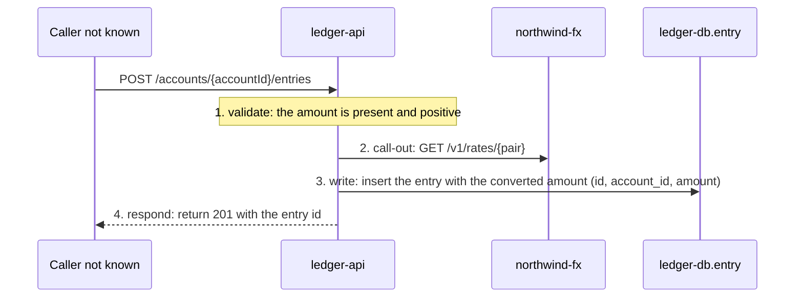

# Post a ledger entry

<!-- Rendered by atticus map render forge-ledger from specs/forge-ledger/ledger-api.post-a-ledger-entry.yaml (ADR 0124). Don't edit: correct the facts and run atticus verify forge-ledger --write. -->

- Component: ledger-api
- Starts at: endpoint `POST /accounts/{accountId}/entries` (`ledger-api.post-entry`): [src/main/java/forge/ledger/EntryController.java:22](https://git.forge.example/forge/forge-ledger/blob/0123abc/src/main/java/forge/ledger/EntryController.java#L22)
- Spec: [ledger-api.post-a-ledger-entry.yaml](../../../specs/forge-ledger/ledger-api.post-a-ledger-entry.yaml)

## Steps

1. **validate**: the amount is present and positive. [src/main/java/forge/ledger/EntryRequest.java:7](https://git.forge.example/forge/forge-ledger/blob/0123abc/src/main/java/forge/ledger/EntryRequest.java#L7)
   - Fields: checks amount
   - Refs: `ledger-api.post-entry.request`
   - Not confirmed yet
2. **call-out** to northwind-fx `GET /v1/rates/{pair}`: fetch the FX rate for the currency pair. [src/main/java/forge/ledger/FxClient.java:31](https://git.forge.example/forge/forge-ledger/blob/0123abc/src/main/java/forge/ledger/FxClient.java#L31)
   - Fields: sends pair
   - Refs: `if-0bb6f0b5cb457f7f`
   - Confirmed by the line check
3. **write** `ledger-db.entry`: insert the entry with the converted amount. [src/main/java/forge/ledger/EntryRepository.java:8](https://git.forge.example/forge/forge-ledger/blob/0123abc/src/main/java/forge/ledger/EntryRepository.java#L8)
   - Fields: columns id, account_id, amount
   - Refs: `ledger-db.entry`
   - Confirmed by the line check
4. **respond**: return 201 with the entry id. [src/main/java/forge/ledger/EntryController.java:30](https://git.forge.example/forge/forge-ledger/blob/0123abc/src/main/java/forge/ledger/EntryController.java#L30)
   - Confirmed by the line check

## Errors

- When the FX service is down: 503 and nothing is written. [src/main/java/forge/ledger/EntryController.java:27](https://git.forge.example/forge/forge-ledger/blob/0123abc/src/main/java/forge/ledger/EntryController.java#L27)

## Sequence

